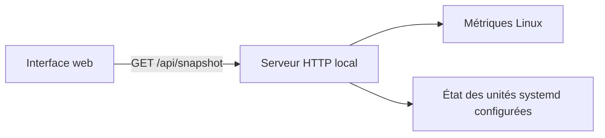

<div align="center">

# Console

**Un panneau d’administration web pour Linux, avec une édition publique consacrée à l’observation.**

Ressources système · État des unités systemd · Lecture seule

[Présentation sur le portfolio](https://purvanas.fr/#console) · [Démarrage](#démarrage) · [Architecture](#architecture) · [Validation](#validation)

</div>

## Pourquoi Console

J’ai créé Console pour administrer un serveur Linux depuis un seul écran. La version privée rassemble la gestion des services PM2 et systemd, le suivi des sites, les journaux, l’exploration des fichiers, les exports MariaDB, le terminal et les alertes.

Ce dépôt contient le volet d’observation, conçu pour fonctionner en local et en lecture seule. Il affiche l’utilisation du processeur, de la mémoire et du disque, le temps écoulé depuis le démarrage et l’état des unités systemd explicitement configurées.

## Le parcours

1. Ouvrir la vue d’ensemble pour vérifier les quatre métriques.
2. Repérer les services qui demandent une vérification avec le filtre **À surveiller**.

Le tableau de bord s’actualise toutes les quinze secondes tant que la page est visible. Il conserve la dernière lecture si une actualisation échoue.

## Démarrage

Il faut **Linux** et **Node.js 22 ou une version plus récente**. Console utilise les modules standards de Node.js.

```sh
npm start
```

Ouvrir **http://127.0.0.1:4178** dans le navigateur.

Pour suivre certaines unités systemd, renseigner une liste séparée par des virgules. Remplacer les noms d’exemple par les unités de sa machine.

```sh
CONSOLE_SERVICES=example-web.service,example-worker.service npm start
```

| Variable | Défaut | Effet |
| --- | --- | --- |
| `CONSOLE_PORT` | `4178` | Port HTTP local entre 1024 et 65535. |
| `CONSOLE_SERVICES` | Vide | Jusqu’à huit unités systemd à observer. Une unité inaccessible est affichée comme indisponible. |

## Architecture



| Besoin | Choix |
| --- | --- |
| Vérifier les ressources d’un coup d’œil | Le serveur renvoie une réponse structurée avec l’usage du CPU, de la mémoire et du disque, ainsi que le temps depuis le démarrage. |
| Réduire les collectes concurrentes | Les requêtes simultanées partagent une lecture, réutilisée pendant deux secondes. |
| Limiter la surface HTTP | Les fichiers servis et la route de lecture sont énumérés. Le serveur écoute sur `127.0.0.1`, vérifie l’en-tête `Host` et refuse les requêtes d’une autre origine. |
| Garder le contrôle sur les services exposés | Seuls les noms configurés sont interrogés. L’appel à systemd transmet ses arguments sans shell, avec un délai et une taille de réponse bornés. |

### Cadre d’utilisation

L’édition est conçue pour un usage local. Garder son port sur la boucle locale et accéder à une machine distante via un canal d’administration de confiance. L’écoute locale suppose que les autres processus exécutés sur la même machine sont de confiance.

## Validation

```sh
npm test
```

Les tests couvrent la configuration, les requêtes HTTP, les routes absentes, le refus des requêtes externes, le partage d’une collecte et la reprise après une erreur. La collecte réelle est testée sur Linux. La CI lance la suite sur Node.js 22 et 24.

Licence [MIT](LICENSE).
