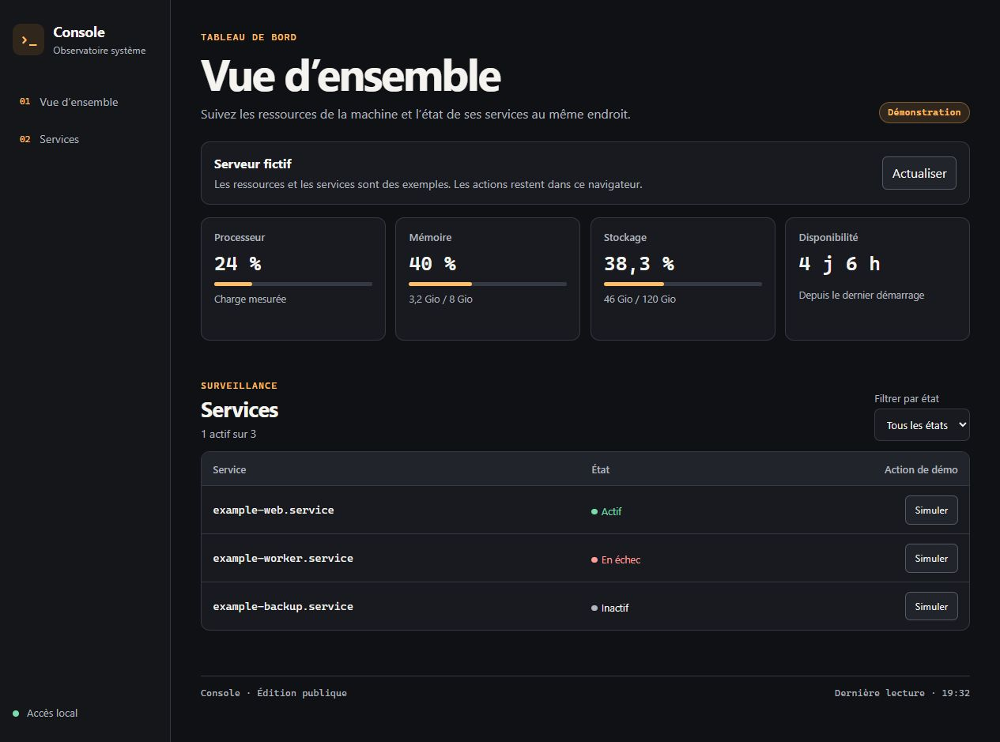
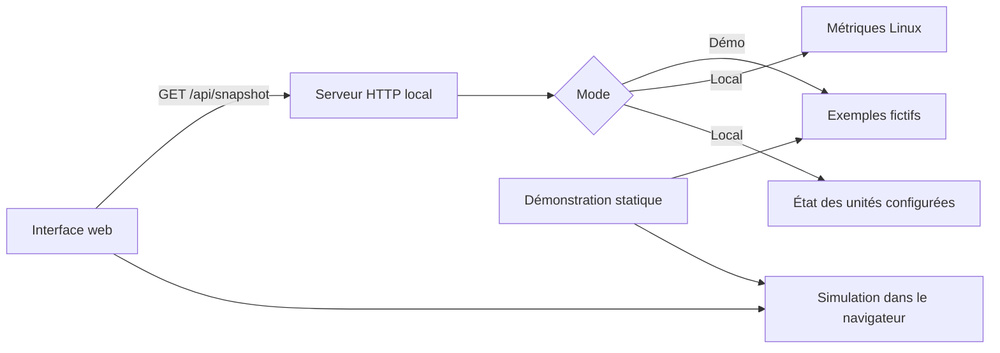

<div align="center">

# Console

**Un tableau de bord local pour observer un serveur Linux depuis le navigateur.**

Ressources système · État des services · Démonstration interactive

[Essayer la démo](https://purvanas.github.io/console/) · [Démarrage](#démarrage) · [Architecture](#architecture) · [Validation](#validation)

</div>



## Pourquoi Console

J’ai créé Console pour retrouver au même endroit les informations qui me servent lors de l’exploitation quotidienne d’un serveur. Je peux vérifier la charge, la mémoire, l’espace disque et la disponibilité des services avant de décider où intervenir.

Cette édition publique reprend le parcours d’observation dans une application autonome. Elle démarre avec un serveur fictif, puis peut lire les métriques d’une machine Linux quand le mode local est activé. Le mode local reste en lecture seule.

## Le parcours

1. Ouvrir la vue d’ensemble pour vérifier les quatre métriques.
2. Repérer les services qui demandent une vérification avec le filtre **À surveiller**.
3. En démonstration, simuler une relance et suivre le passage du service à l’état **Actif**. La simulation s’exécute dans le navigateur et se réinitialise au rechargement.

Les services de la démonstration sont des exemples. Le tableau de bord s’actualise toutes les quinze secondes tant que la page est visible. Il conserve la dernière lecture si une actualisation échoue.

## Démarrage

Il faut **Node.js 22 ou une version plus récente**. Il n’y a ni dépendance npm ni compilation.

```sh
npm start
```

Ouvrir **http://127.0.0.1:4178**. La démonstration fonctionne sur Linux, macOS et Windows.

### Lecture réelle sur Linux

```sh
CONSOLE_MODE=local npm start
```

Pour suivre certaines unités systemd, renseigner une liste séparée par des virgules. Remplacer les noms d’exemple par les unités de sa machine.

```sh
CONSOLE_MODE=local CONSOLE_SERVICES=example-web.service,example-worker.service npm start
```

| Variable | Défaut | Effet |
| --- | --- | --- |
| `CONSOLE_MODE` | `demo` | `local` active la lecture des métriques Linux. |
| `CONSOLE_PORT` | `4178` | Port HTTP local entre 1024 et 65535. |
| `CONSOLE_SERVICES` | Vide | Jusqu’à huit unités systemd à observer. Une unité inaccessible est affichée comme indisponible. |

### Démonstration statique

```sh
npm run build:pages
```

Servir le dossier `dist-pages/` avec un hébergement statique. Le navigateur charge les exemples et joue les simulations dans l’onglet. Les mêmes exemples alimentent la démonstration lancée avec Node.js.

Pour GitHub Pages, sélectionner **GitHub Actions** dans **Settings → Pages → Source**, puis lancer le workflow **Démonstration GitHub Pages** depuis `main`. Il téléverse uniquement `dist-pages/`. La page reste utilisable sous un sous-chemin comme `/console/`. [Documentation GitHub Pages](https://docs.github.com/en/pages/getting-started-with-github-pages/using-custom-workflows-with-github-pages)

## Architecture



| Besoin | Choix |
| --- | --- |
| Vérifier les ressources d’un coup d’œil | Le serveur renvoie une réponse structurée avec l’usage du CPU, de la mémoire et du disque, ainsi que le temps depuis le démarrage. |
| Réduire les collectes concurrentes | Les requêtes simultanées partagent une lecture, réutilisée pendant deux secondes. |
| Limiter la surface HTTP | Les fichiers servis et la route de lecture sont énumérés. Le serveur écoute sur `127.0.0.1`, vérifie l’en-tête `Host` et refuse les requêtes d’une autre origine. |
| Garder le contrôle sur les services exposés | Seuls les noms configurés sont interrogés. L’appel à systemd transmet ses arguments sans shell, avec un délai et une taille de réponse bornés. |

### Cadre d’utilisation

L’édition est conçue pour un usage local. Garder son port sur la boucle locale et accéder à une machine distante via un canal d’administration de confiance. L’écoute locale suppose que les autres processus exécutés sur la même machine sont de confiance. Le terminal, les actions sur le serveur, les fichiers et les intégrations de l’instance personnelle restent hors de cette édition.

## Validation

```sh
npm test
```

Les tests couvrent la configuration, les requêtes HTTP, les routes absentes, le refus des requêtes externes, le partage d’une collecte et la reprise après une erreur. La collecte réelle est testée sur Linux. La CI lance la suite sur Node.js 22 et 24.

Licence [MIT](LICENSE).
